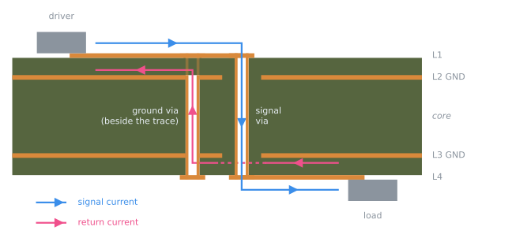
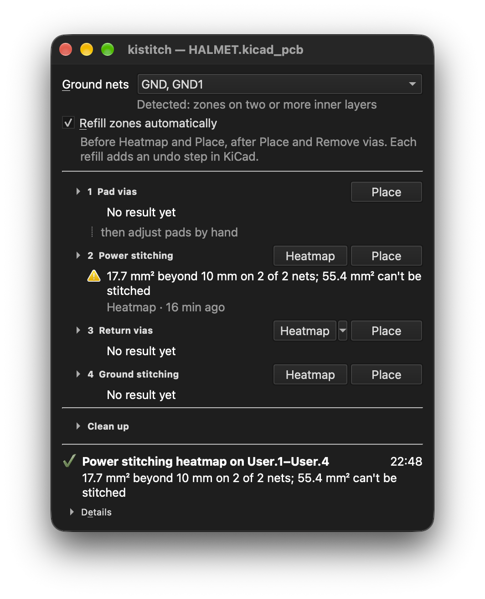

# kistitch

kistitch places ground return vias, pad vias and pour stitching vias on the board open in KiCad's PCB editor, and shows heatmaps of where vias are missing. Every run is checked with KiCad's DRC before kistitch commits it to the board.

| Before: `kistitch returnvia --check --overlay` | After: `kistitch returnvia --overlay` |
|---|---|
|  |  |

The return distance heatmap on F.Cu of a four-layer board, before and after placing return vias. Each pink ring marks a via end with no ground return within 1.5 mm through its reference plane. The rings left after the run mark the vias the planner couldn't serve; those you fix by hand.

## Why

At high frequencies, the return current of a signal flows on the nearest reference plane, concentrated beneath the trace. A digital signal's bandwidth is about 0.35/t_r, so a 1 ns edge reaches 350 MHz whatever the clock rate: modern edge rates make every digital signal high frequency in this sense.

A signal going through a via from L1 to L4 changes its reference plane from L2 to L3, and its return current has to cross between the two planes. A ground via next to the signal via gives it a short path. Without one, the return current takes a longer path between the planes, and the thick core between L2 and L3 of a typical four-layer board makes that loop larger still.



Howard Johnson's ["Short-Term Impedance of Planes"](https://www.sigcon.com/Pubs/news/6_05.htm) covers the physics in more depth.

For good return paths, kistitch recommends a solid ground plane next to every signal layer. On four layers, that is SIG+PWR / GND / GND / SIG+PWR: power is routed as tracks on the outer layers, or poured as copper between the traces.

Both ground and power then need stitching to the same nets on the other layers:

- Ground stitching makes the two ground planes act as one reference.
- With orthogonal routing, for example vertical on L1 and horizontal on L4, each outer-layer power pour breaks into fingers. Stitching ties the pours of the two layers into one mesh, which lowers the impedance between the loads and the bypass capacitors on either layer.
- kistitch's automatic power stitching, which brings every point of a pour within 10 mm of a via, is a baseline. You usually add vias by hand where the heatmap shows gaps.

Stitching by hand is tedious, and areas with poor connectivity are hard to spot. kistitch places the vias, and its heatmaps show what is left.

## What it does

- **Pad vias** give an SMD pad a via and a short stub track into its net's plane or pour on another layer. Only pads of nets with zones on two or more copper layers get one, and a pad that already reaches a same-net via or through-hole pad within 1 mm is skipped.
- **Pour stitching** places vias so every point of a net's pours lies within a distance of a via, measured through the copper rather than in a straight line. Ground nets are stitched at 3 mm, power and other nets at 10 mm. Only nets with pours on two or more copper layers are stitched.
- **Return vias** give every via on a non-ground net a ground via within 1.5 mm, through each reference plane it uses.
- **Heatmaps** show return distance and pour coverage, placed on the board as reference images or written to a file, for checking a layout and placing vias by hand.

| Before: `kistitch pourstitch --power --check --overlay` | After: `kistitch pourstitch --power --overlay` |
|---|---|
|  |  |

Power pour coverage on F.Cu. Pink copper is more than 10 mm from a stitching via, measured through the copper.

| Before: `kistitch pourstitch --check --overlay` | After: `kistitch pourstitch --overlay` |
|---|---|
|  |  |

Ground plane coverage on In1.Cu, after power stitching and return vias. Pink copper is more than 3 mm from a stitching via. The pink left after the run, here next to the through-hole pads, is copper where no via fits.

## Install

kistitch installs from KiCad's Plugin and Content Manager:

1. In the Plugin and Content Manager, open Manage repositories and add `https://github.com/hatlabs/kistitch/releases/download/pcm/repository.json`.
2. Choose kistitch in the repository list at the top of the window; adding a repository does not show it. Install kistitch from the Plugins tab and apply the changes.
3. Open a board in the PCB editor and press the kistitch button in the toolbar.

kistitch runs outside KiCad. The first press of the button offers to install [uv](https://docs.astral.sh/uv/) and kistitch with its panel, which needs an internet connection, and installs nothing until you agree. Later presses open the panel, or bring it to the front.

kistitch needs KiCad 10 and kicad-python 0.8 or later.

### Without the plugin manager

kistitch is on PyPI. Name Python 3.14 when installing it: uv otherwise picks the newest Python, and one of kistitch's dependencies has no packages for 3.15 yet:

```sh
uv tool install --python 3.14 'kistitch[gui]'
```

Without the `gui` extra you get only the [command line](https://github.com/hatlabs/kistitch/blob/main/docs/cli.md).

### Before the first run

- **Enable the KiCad API** in Preferences > Plugins > Enable KiCad API. Only one KiCad instance can serve the API at a time, so close other KiCad windows if kistitch can't find the open board.
- **Save rule and netclass changes** before a run. The DRC check reads the saved `.kicad_pro` and `.kicad_dru` from disk. The board itself is read from the editor, unsaved changes included.
- **Set the zones' Remove islands to Never.** KiCad then keeps unconnected islands in the fill, and kistitch can place vias in them to connect them. Islands it can't stitch show as isolated copper in DRC.

## Using it



The panel runs on the board open in the PCB editor. **Ground nets** starts with the detected ground nets: the nets with zones on two or more inner layers. Each step has **Place**, and all but the first have **Heatmap**, which places the step's heatmap on the board without placing vias. Run the steps in order:

1. **Pad vias.** Place, then look at the circles on User.Eco2: each marks a pad where no via fits. Adjust those pads by hand.
2. **Power stitching.** Place, then Heatmap. Add vias by hand at the ends of power pours that are still pink, and where a pour carries high current.
3. **Return vias.** Place. It gives a return to every via on a non-ground net, the power stitching vias included. Fix the vias it circles by hand, then run Heatmap to confirm none is left.
4. **Ground stitching.** Place. It counts the return vias as ground stitches, so it only fills the gaps they leave. Around an RF section, add ground vias by hand: 3 mm is not dense enough there (see [Pour stitching](https://github.com/hatlabs/kistitch/blob/main/docs/pour-stitching.md#why-power-is-sparse-and-ground-dense)).

Power stitching goes before return vias because its vias need returns, and ground stitching goes last because the return vias count towards it.

Finish with Heatmap on Power stitching and on Return vias. Steps 3 and 4 place ground vias inside the outer-layer power pours, which can lengthen paths through power fingers. After later hand edits, run both checks again.

**Clean up** has **Clear markers and heatmaps**, and **Remove vias…**, which counts the stitching vias on the chosen nets and asks before removing them.

[The panel](https://github.com/hatlabs/kistitch/blob/main/docs/panel.md) describes each field, option and status line.

## What a run changes

- A run commits its vias as one undo step. With refills on, it then refills the zones as a second step, so undoing a placement takes two Ctrl+Z: one for the refill and one for the commit. With refills off, it takes one. A Heatmap run after the placement adds undo steps of its own, which come off first.
- Markers for spots that need attention go on User.Eco2. Each Place, and each Heatmap, removes every shape on User.Eco2, hand-drawn ones included, before adding its own.
- Before committing, kistitch runs KiCad's DRC on a copy of the board with the planned vias, and drops vias that cause new violations.
- Other nets' pours are not obstacles, so a via can cut a narrow neck of another net's pour. The run commits anyway and marks each such cut with a square on User.Eco2 for fixing by hand.
- Heatmaps go on User.1 to User.4 by default, one per copper layer, as reference images. Clear markers and heatmaps removes them. The panel always uses those four layers, so its Heatmap fails on a board with more than four copper layers; there, run `kistitch <command> --check --overlay --overlay-layers LAYER ...` with one user layer per copper layer, or `--check --render PATH`.

**Remove vias, or `kistitch clear --vias`, removes every unlocked via that touches a pour of its own net and that no track or pad ties down, including vias you placed by hand.** To keep such a via, connect it with a short track or lock it.

## Limits

- Return vias assume that the plane next to each signal layer is ground. On a SIG-GND-PWR-SIG board, B.Cu's real reference is the power plane on In2. With no ground zone on In2, kistitch measures B.Cu via ends against the ground plane on In1 instead. See [Return vias](https://github.com/hatlabs/kistitch/blob/main/docs/return-vias.md).
- The planners keep fixed clearances, such as 0.3 mm to other-net copper and 0.5 mm from the board edge, listed in [Markers and DRC](https://github.com/hatlabs/kistitch/blob/main/docs/markers-and-drc.md). They don't read custom design rules; only the DRC check enforces those.
- Placed vias can't be grouped, because KiCad 10 doesn't create groups through its API.

## How it works

**Return vias.** For each end of a signal via, kistitch takes the nearest other copper layer with a ground zone at the via as its reference plane, and measures the distance through that plane's ground fill to the nearest ground via or through-hole pad. For a via beyond the limit, it tries spots on rings around it, nearest first, and takes the first with full clearance that serves every unserved end.

**Pour stitching.** kistitch rasterises each net's pours at 0.1 mm, places vias on a square lattice, then fills the remaining gaps one at a time, farthest point first. A finger 2 mm from a via across a gap but 8 mm away along the copper counts as 8 mm. Narrow spots get a smaller fallback via.

## Command line

The panel's steps are commands of `kistitch`:

```sh
kistitch padvia
kistitch pourstitch --power
kistitch returnvia
kistitch pourstitch
```

`--check --overlay` places a step's heatmap without placing vias, and `kistitch --dry-run <command>` plans and runs DRC without placing vias. A dry run still refills the zones and places its `--overlay` heatmap. [Command line](https://github.com/hatlabs/kistitch/blob/main/docs/cli.md) lists every option.

## Documentation

- [Return vias](https://github.com/hatlabs/kistitch/blob/main/docs/return-vias.md)
- [Pad vias](https://github.com/hatlabs/kistitch/blob/main/docs/pad-vias.md)
- [Pour stitching](https://github.com/hatlabs/kistitch/blob/main/docs/pour-stitching.md)
- [Heatmaps](https://github.com/hatlabs/kistitch/blob/main/docs/heatmaps.md)
- [Markers and DRC](https://github.com/hatlabs/kistitch/blob/main/docs/markers-and-drc.md)
- [Clearing vias](https://github.com/hatlabs/kistitch/blob/main/docs/clearing.md)
- [The panel](https://github.com/hatlabs/kistitch/blob/main/docs/panel.md)
- [Command line](https://github.com/hatlabs/kistitch/blob/main/docs/cli.md)
- [Development](https://github.com/hatlabs/kistitch/blob/main/docs/development.md)

kistitch uses the KiCad IPC API through [kicad-python](https://pypi.org/project/kicad-python/).
