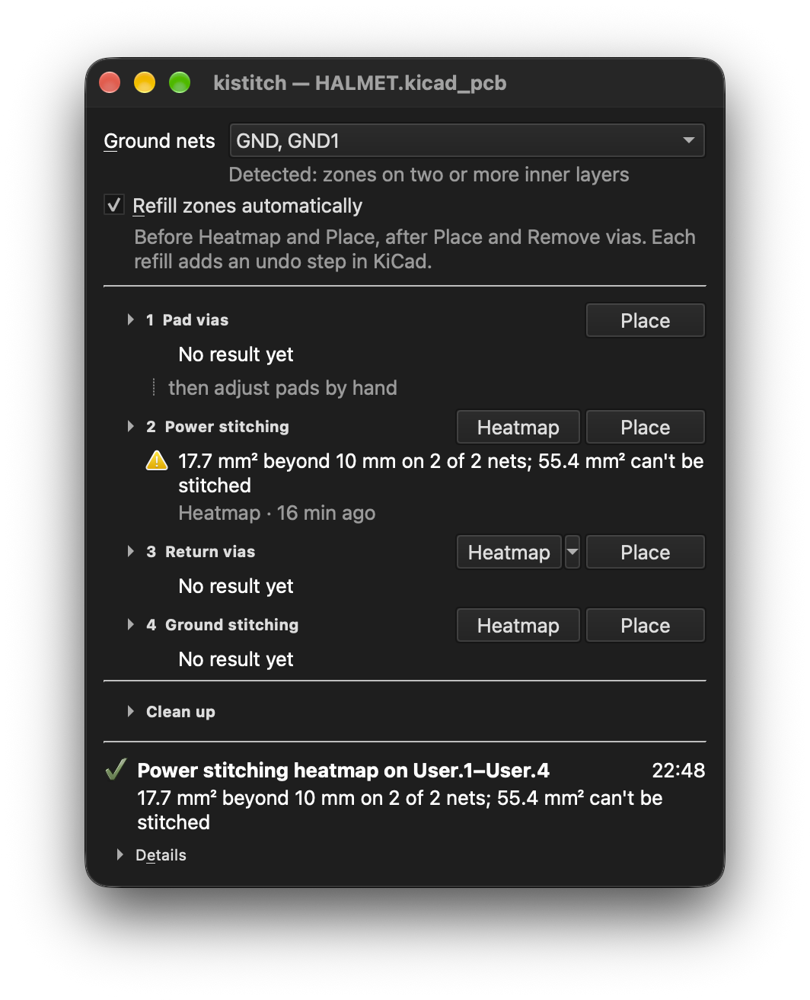

# The panel

This page describes the panel, a window beside KiCad's PCB editor that runs kistitch's steps on the open board, one action at a time, and keeps each step's latest result in view. For an overview and the first run, see the [README](../README.md).

## Opening it

The kistitch button in the PCB editor's toolbar opens the panel. The plugin from KiCad's Plugin and Content Manager adds the button (see the [README](../README.md)).

From a terminal, run `kistitch-panel`. It needs the `gui` extra, installed as in [Without the plugin manager](../README.md#without-the-plugin-manager); without it, the command says how to install it.

There is one panel per KiCad: pressing the button again, or starting `kistitch-panel` again for the same KiCad, brings the open panel to the front instead of opening another.

## From top to bottom

**Ground nets** sets the ground nets for return vias and both stitching steps. It starts with the detected nets, found as for `returnvia` (see [Ground nets](return-vias.md#ground-nets)). Choose others from the drop-down; **Use detected** goes back to the detected nets. Return vias and ground stitching can't run without a ground net, and say so. Power stitching without a ground net stitches every net with pours.

**Refill zones automatically** is the panel's `--refill` / `--no-refill` for every step and for Remove vias (see [Zone refills](cli.md#zone-refills)).

The four steps, in their usual order:

1. **Pad vias**: **Place** runs `padvia`. Adjust the pads by hand before going on.
2. **Power stitching**: **Heatmap** places the coverage heatmap, as `pourstitch --power --check --overlay`, and **Place** runs `pourstitch --power`.
3. **Return vias**: **Heatmap** shows the unserved vias, as `returnvia --check --overlay`. Its menu adds **All copper**, as `--full-map`. **Place** runs `returnvia`.
4. **Ground stitching**: **Heatmap** and **Place**, as for power stitching, run `pourstitch` on the ground nets.

Each Heatmap, like each Place, removes every shape on User.Eco2, hand-drawn ones included, before adding its own markers.

**Clean up**:

- **Clear markers and heatmaps** runs `clear`. Hand-drawn shapes on User.Eco2 go too.
- **Remove vias…** counts the stitching vias on the nets chosen under **Stitching vias on**, asks with the count per net, then removes them as `clear --vias` does (see [Clearing](clearing.md) for which vias that removes).

The activity area at the bottom shows what is running, with **Cancel (Esc)**, and then how it ended. **Details** shows the action's log, which names where DRC dropped a via and where a via was forced, with **Copy**.

## Step options

The arrow beside a step opens its options, which are the command's:

- **Nets**, for pad vias and both stitching steps;
- **Distance**, for the stitching steps and return vias;
- **Via size**, empty for the netclass's size;
- **Force a via where none fits**, for return vias (see [Forced vias](return-vias.md#forced-vias));
- **Fallback via**, under **More options**, for the stitching steps.

**Restore defaults** resets them.

The panel places heatmaps on User.1–User.4, one per copper layer, and has no setting for other layers. On a board with more than four copper layers its Heatmap fails; run `kistitch <command> --check --overlay --overlay-layers LAYER ...` with one user layer per copper layer, or `--check --render PATH`, instead (see [Heatmaps](heatmaps.md#overlays-on-the-board)).

Every placement allows pour splits and marks them, as the command line does by default (see [Pour splits](markers-and-drc.md#pour-splits)). The panel has no dry run.

## Status lines

Under each step, its status line gives the step's latest Heatmap or Place in this session and how long ago. It notes when a later panel action replaced or cleared that step's markers or heatmap. The panel doesn't notice undo or edits in KiCad and doesn't re-check a result: after editing the board, run the step again.

Cancel stops an action before its commit. From the commit on, the action runs to the end.

A failed or cancelled action, or one that KiCad was too busy for, leaves the status lines as they were. When KiCad was busy, close the open tool or dialog in the PCB editor and press **Try again**.

The panel reads the board when its window comes to the front and on **Retry**. When KiCad shows another board, the status lines and the ground net choice are cleared.
